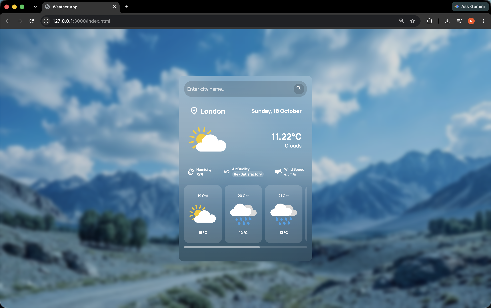

# Weather App

A clean, responsive weather web application that lets users search for a city and view its current weather conditions, air quality information, and upcoming forecast in one place.

## Preview



## Features

- **City Search** — Search for weather information by city name.
- **Current Weather** — View the current temperature and weather conditions.
- **Humidity** — Check the current humidity level.
- **Wind Speed** — View current wind speed.
- **Air Quality** — Display air-quality information when the air pollution data is available.
- **Multi-day Forecast** — Browse upcoming forecast cards with dates, weather icons, and temperatures.
- **Weather Icons** — Show visual icons that match weather conditions.
- **Responsive, Glassmorphism-Inspired UI** — A translucent interface designed to keep weather information readable over a scenic background.

## Built With

- HTML5
- CSS3
- JavaScript
- [OpenWeather API](https://openweathermap.org/api)

## Getting Started

### 1. Clone the repository

```bash
git clone <YOUR_REPOSITORY_URL>
cd <YOUR_PROJECT_FOLDER>
```

### 2. Get an API key

Create an account with [OpenWeather](https://openweathermap.org/) and generate an API key. The application uses OpenWeather endpoints to retrieve current weather and forecast data. Air-quality information uses the Air Pollution API.

### 3. Configure your API key

Create a local `config.js` file in the project root and expose your key in the format expected by your application:

```js
window.apiKey = "YOUR_OPENWEATHER_API_KEY";
```

Make sure `config.js` is loaded before `script.js` in your HTML.

**Important:** Add `config.js` to `.gitignore` so it is not committed to your repository. This keeps it out of GitHub, but it does **not** make the key secret in a browser-based app: visitors can inspect client-side JavaScript and network requests. For a publicly deployed app, use a backend or serverless function to protect the key where the API and plan allow it.

### 4. Run the app

Open `index.html` in your browser, or use a local development server such as the VS Code Live Server extension.

## Project Structure

Your exact filenames may differ; a typical structure for this project is:

```text
weather-app/
├── assets/
│   └── weather/
├── config.js
├── index.html
├── script.js
├── style.css
└── README.md
```

## How It Works

1. Enter a city name in the search field.
2. The application requests weather data from OpenWeather.
3. The current-weather section displays the returned conditions.
4. The forecast section shows upcoming forecast entries.
5. Air-quality information can be retrieved separately through OpenWeather's Air Pollution API using latitude and longitude.

## Future Improvements

- Add a loading indicator while requests are in progress.
- Improve handling of invalid city names and network/API errors.
- Add a Celsius/Fahrenheit toggle.
- Add sunrise and sunset times.
- Add hourly forecasts and precipitation probability.
- Add current-location weather using browser geolocation.
- Improve accessibility and mobile layouts.

## Author

**Nitye Jain**

- GitHub: [NityeJain1008](https://github.com/NityeJain1008)
- LeetCode: [nityejain1008](https://leetcode.com/u/nityejain1008/)

---

*Weather data is provided by OpenWeather. Availability and accuracy depend on the API response and service coverage.*
